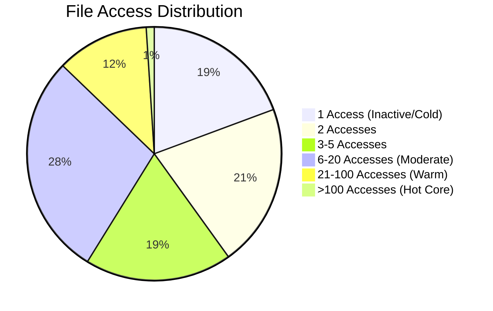
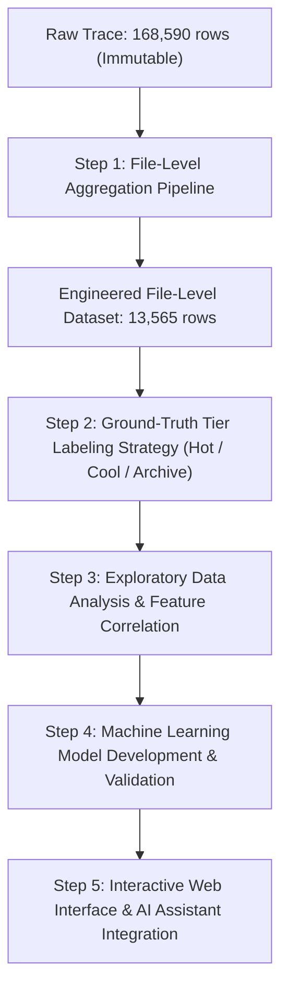

# Comprehensive Dataset Analysis: Google Thesios Storage Trace

**Project:** Intelligent Cloud Storage Tier Predictor Using Machine Learning  
**Dataset Source:** `data/raw/thesios_storage_trace.csv` (Real Google Thesios Storage I/O Trace)  
**Analysis Date:** October 2026  
**Status:** Task 1 Complete — Dataset Analysis & File-Level Feature Engineering Plan  

---

## 1. Dataset Overview

The dataset `thesios_storage_trace.csv` is an empirical I/O access trace extracted from Google's **Thesios** distributed storage research environment (built atop Google's Colossus / CFS file system architecture).

| Metric | Actual Value | Details |
| :--- | :--- | :--- |
| **File Path** | `data/raw/thesios_storage_trace.csv` | Immutable raw storage trace |
| **File Size on Disk** | `41,543,814 bytes` (~41.5 MB) | UTF-8 encoded text CSV |
| **Total Rows (Records)** | **168,590** | Each row represents a single I/O event |
| **Total Columns** | **17** | Heterogeneous schema (numeric, temporal, categorical) |
| **Total Unique Files** | **13,565** | Distinct files referenced across I/O requests |
| **Granularity Level** | **I/O Event / Request Level** | Block/chunk I/O operations (NOT file-level) |
| **Trace Observation Duration** | **861.38 seconds** (~14.36 minutes) | High-resolution trace window on 2024-01-15 |
| **Creation History Span** | **902.55 days** (~2.47 years) | Historical creation timestamps (`c_time`) |

> [!NOTE]
> The raw dataset is an **I/O access trace**, capturing fine-grained read/write requests, byte offsets, cache dynamics, and latencies. Because cloud storage tiering operates at the **logical file level**, the primary engineering objective is aggregating these 168,590 access events into a clean, 13,565-row **file-level dataset**.

---

## 2. Column Dictionary

Below is the complete dictionary of all 17 columns present in `thesios_storage_trace.csv`:

| # | Column Name | Raw Data Type | Inferred Semantics | Cardinality | Value Range / Classes | Domain Role |
| :---: | :--- | :---: | :--- | :---: | :--- | :--- |
| 1 | `filename` | `string` (object) | Anonymized SHA-256 identifier of the target file | 13,565 | 64-character hex strings | Primary Entity Key |
| 2 | `file_offset` | `int64` | Byte offset within the file where I/O began | 49,126 | `0` to `66,189,312` bytes (~63.1 MB) | Access Locality / File Size Proxy |
| 3 | `application` | `string` (object) | Client application / service initiating I/O | 76 | `spanner`, `bigtable`, `blobstore`, + 73 SHA-256 hashes | Workload Context |
| 4 | `c_time` | `int64` | File creation timestamp (Unix epoch seconds) | 9,717 | `1,627,326,263` to `1,705,306,460` (2021-07 to 2024-01) | Temporal / File Age |
| 5 | `io_zone` | `string` (object) | Storage allocation tier / zone in Thesios | 3 | `WARM` (96.82%), `COLD` (3.16%), `UNKNOWN` (0.02%) | Existing System Allocation |
| 6 | `redundancy_type` | `string` (object) | Data protection / replication scheme | 2 | `REPLICATED` (65.77%), `ERASURE_CODED` (34.23%) | Reliability / Cost Factor |
| 7 | `op_type` | `string` (object) | Operation type | 2 | `WRITE` (53.47%), `READ` (46.53%) | Access Pattern |
| 8 | `service_class` | `string` (object) | Quality of Service (QoS) performance profile | 3 | `THROUGHPUT_ORIENTED`, `LATENCY_SENSITIVE`, `OTHER` | SLA / Traffic Priority |
| 9 | `from_flash_cache` | `int64` (binary) | Flag indicating if served by flash/SSD cache | 2 | `0` (94.64%), `1` (5.36%) | Cache Acceleration |
| 10 | `cache_hit` | `int64` (enum) | Cache hit status of the request | 3 | `-1` (N/A for Writes: 53.47%), `0` (Miss: 23.82%), `1` (Hit: 22.72%) | Cache Effectiveness |
| 11 | `request_io_size_bytes` | `int64` | Size requested by the client application (bytes) | 31,173 | `0` to `8,404,992` bytes (~8.01 MB) | Workload I/O Volume |
| 12 | `disk_io_size_bytes` | `int64` | Actual bytes transferred to physical media | 30,641 | `0` to `8,417,280` bytes (~8.03 MB) | Physical Media Load |
| 13 | `response_io_size_bytes` | `int64` | Size of payload returned in response | 1,433 | `0` to `8,404,992` bytes (~8.01 MB) | Transfer Volume |
| 14 | `start_time` | `float64` | Timestamp when I/O request arrived (Unix epoch) | 168,547 | `1,705,305,600.016` to `1,705,306,461.401` | Temporal Event Clock |
| 15 | `disk_time` | `float64` | Time spent executing on physical disk (seconds) | 40,063 | `0.000000` to `0.222580` seconds (max ~222.6 ms) | Media Latency |
| 16 | `simulated_disk_start_time` | `float64` | Disk scheduler simulation start timestamp | 40,151 | `0.0` or `1,705,305,600.019` to `1,705,306,461.421` | Simulator Clock |
| 17 | `simulated_latency` | `float64` | End-to-end simulated request latency (seconds) | 130,440 | `0.000016` to `0.375653` seconds (~16 µs to ~375.7 ms) | End-to-End Latency |

---

## 3. Data Quality Analysis

A rigorous assessment of data integrity, completeness, and consistency was conducted across all 168,590 records:

### 3.1 Missing Values
* **Result:** **0 missing values across all 17 columns.**  
* **Completeness:** **100.00%**. There are no nulls, empty strings, or `NaN` representations in the dataset.

```
filename: 0 (0.00%)       cache_hit: 0 (0.00%)
file_offset: 0 (0.00%)    request_io_size_bytes: 0 (0.00%)
application: 0 (0.00%)    disk_io_size_bytes: 0 (0.00%)
c_time: 0 (0.00%)         response_io_size_bytes: 0 (0.00%)
io_zone: 0 (0.00%)        start_time: 0 (0.00%)
redundancy_type: 0 (0.00%) disk_time: 0 (0.00%)
op_type: 0 (0.00%)        simulated_disk_start_time: 0 (0.00%)
service_class: 0 (0.00%)  simulated_latency: 0 (0.00%)
from_flash_cache: 0 (0.00%)
```

### 3.2 Duplicate Records
* **Result:** **0 full duplicate records.**  
* Every row represents an individual, timestamped I/O request with sub-microsecond event resolution.

### 3.3 Temporal Consistency
* Every record was checked for temporal ordering:
  $$\text{Temporal Violations} = \sum (\text{c\_time} > \text{start\_time}) = 0$$
* No file was ever accessed prior to its recorded creation time (`c_time`).

### 3.4 Domain-Specific Data Characteristics
1. **Zero-Byte Requests (`request_io_size_bytes == 0`):**
   * Exactly **25,833 records (15.32%)** have `request_io_size_bytes == 0`.
   * **Domain Finding:** 100% of these 25,833 records have `op_type == 'WRITE'`. In enterprise distributed storage systems (e.g., Google Colossus / Spanner / Bigtable), zero-byte writes correspond to **metadata sync / flush / commit barrier operations** (e.g., `fsync` / `fdatasync`), which verify persistent write state without transmitting new application payload.
2. **Cache Hit Encoding (`cache_hit`):**
   * `cache_hit == -1`: Exactly **90,144 records (53.47%)**, matching 100% of all `WRITE` operations. In Thesios, writes do not evaluate read cache hits.
   * `cache_hit == 0`: Exactly **40,150 records (23.82%)**, representing `READ` cache misses.
   * `cache_hit == 1`: Exactly **38,296 records (22.72%)**, representing `READ` cache hits.
   * **Effective Read Cache Hit Rate:**
     $$\text{Read Hit Rate} = \frac{38,296}{40,150 + 38,296} = \frac{38,296}{78,446} \approx \mathbf{48.82\%}$$
3. **Physical Media Bypass (`disk_time == 0` and `simulated_disk_start_time == 0`):**
   * Exactly **128,440 records (76.18%)** bypass physical spinning disk I/O.
   * Breakdown: All 90,144 writes (buffered/appended asynchronously) + all 38,296 read cache hits.
   * The remaining **40,150 records (23.82%)** correspond precisely to the read cache misses that required physical disk retrieval.

---

## 4. Unique File Analysis

* **Total Distinct Files:** **13,565 unique files** across 168,590 I/O operations.
* **Filename Representation:** 64-character SHA-256 hex strings (e.g., `d206e7d484caba36fa936dffa618118382e36e0a616a4117f4d13d06b7dc7fe6`).
* **Mean Accesses Per File:** **12.43**
* **Standard Deviation:** **65.25**
* **Median Accesses Per File:** **4**
* **Interquartile Range:** Q1 = 2, Q3 = 14

### File Access Frequency Distribution (Heavy-Tailed / Pareto Profile)

```
Access Count Range     Number of Files    Percentage    Cumulative %
────────────────────────────────────────────────────────────────────
Exactly 1 access       2,622 files         19.33%         19.33%
Exactly 2 accesses     2,817 files         20.77%         40.10%
3 to 5 accesses        2,538 files         18.71%         58.81%
6 to 20 accesses       3,854 files         28.41%         87.22%
21 to 100 accesses     1,596 files         11.77%         98.98%
> 100 accesses           138 files          1.02%        100.00%
────────────────────────────────────────────────────────────────────
Total                 13,565 files        100.00%
```



### Key Distribution Findings:
1. **Heavy Skew:** Over **40% of all files** are accessed only 1 or 2 times during the trace window.
2. **Top 1% Dominance:** Just 138 files (>100 accesses each) account for a substantial fraction of overall cluster traffic. The single hottest file in the trace accumulated **4,210 accesses** within 14.36 minutes.
3. **Storage Tiering Opportunity:** This heavy-tail distribution aligns directly with real-world enterprise tiering dynamics, where a small fraction of files drives massive I/O (**Hot**), a moderate tier handles periodic operational traffic (**Cool**), and inactive/rarely touched files sit idle (**Archive**).

---

## 5. Timestamp Analysis

The dataset incorporates two distinct temporal reference columns: `start_time` and `c_time`.

### 5.1 Access Timeline (`start_time`)

| Property | Timestamp (Epoch Seconds) | Formatted UTC Date & Time |
| :--- | :--- | :--- |
| **Trace Earliest Access** | `1,705,305,600.0159895` | `2024-01-15 08:00:00.016 UTC` |
| **Trace Latest Access** | `1,705,306,461.4007087` | `2024-01-15 08:14:21.401 UTC` |
| **Total Observation Duration** | **861.3847 seconds** | **14 minutes, 21.38 seconds** (~0.239 hours) |

* **Trace Window Context:** The access trace captures a continuous, high-fidelity 14-minute 21-second trace segment starting precisely at 08:00:00 UTC on January 15, 2024.
* **Access Rate:** Across 861.38 seconds, 168,590 I/O requests were executed, yielding an average cluster throughput of **195.72 I/O operations per second**.

### 5.2 Creation Timeline (`c_time`)

| Property | Timestamp (Epoch Seconds) | Formatted UTC Date & Time |
| :--- | :--- | :--- |
| **Earliest File Created** | `1,627,326,263` | `2021-07-26 19:04:23 UTC` |
| **Latest File Created** | `1,705,306,460` | `2024-01-15 08:14:20 UTC` |
| **Creation Span Covered** | **77,980,197 seconds** | **902.55 days** (~2.47 years) |

### 5.3 Derived File Age Analysis

Because `c_time` ranges from 2021 to the exact moment of the trace capture in 2024, files present in the trace have drastically different ages:

$$\text{File Age (Days)} = \frac{\text{Trace End Time} - \text{c\_time}}{86,400}$$

| Statistic | File Age at Trace Observation (Days) | Interpretation |
| :--- | :---: | :--- |
| **Minimum** | `0.000016 days` (~1.4 seconds) | Ephemeral file created *during* the active trace window |
| **25th Percentile (Q1)** | `0.008338 days` (~12.0 minutes) | Very recently created active working files |
| **Median (Q2)** | `0.365167 days` (~8.76 hours) | Files created earlier during the same operating day |
| **75th Percentile (Q3)** | `2.455977 days` (~2.46 days) | Files created over the prior weekend/days |
| **Mean** | `6.199045 days` | Average file age across unique files |
| **Maximum** | `902.548593 days` (~2.47 years) | Long-lived persistent archive/database baseline files |

---

## 6. Access Behavior Analysis

### 6.1 Distribution of Operation Types (`op_type`)

| Operation Type | Event Count | Percentage |
| :--- | :---: | :---: |
| **WRITE** | 90,144 | 53.47% |
| **READ** | 78,446 | 46.53% |
| **Total** | 168,590 | 100.00% |

* Workload is fairly balanced with a slight write bias (53.5% writes vs. 46.5% reads).
* At the file level, **mean read ratio** is `70.37%` (many files are read-mostly, while write-heavy files experience large bursts of repeated appends).

### 6.2 Distribution of I/O Zones (`io_zone`)

| I/O Zone | Event Count | Percentage of I/O | Unique Files Count | % of Unique Files |
| :--- | :---: | :---: | :---: | :---: |
| **WARM** | 163,222 | 96.82% | 12,850 | 94.73% |
| **COLD** | 5,331 | 3.16% | 678 | 5.00% |
| **UNKNOWN** | 37 | 0.02% | 37 | 0.27% |
| **Total** | 168,590 | 100.00% | 13,565 | 100.00% |

* In the existing Google Thesios configuration, the storage cluster was primarily provisioned under `WARM`, with a small active `COLD` partition and 37 unclassified files.

### 6.3 Distribution of Redundancy Schemes (`redundancy_type`)

| Redundancy Scheme | Event Count (I/O) | % of Events | Unique Files Count | % of Unique Files |
| :--- | :---: | :---: | :---: | :---: |
| **REPLICATED** | 110,881 | 65.77% | 5,380 | 39.66% |
| **ERASURE_CODED** | 57,709 | 34.23% | 8,185 | 60.34% |

> [!IMPORTANT]
> **Key Architecture Insight:** Notice the inverse distribution between I/O events and unique files:
> * **60.34% of unique files** are `ERASURE_CODED`, but they generate only 34.23% of total I/O.
> * **39.66% of unique files** are `REPLICATED`, but they generate **65.77% of total I/O**.
> * In cloud systems, high-traffic/hot files are replicated for raw throughput and low latency, whereas colder/infrequently accessed files are erasure-coded to reduce storage footprint. This provides an excellent foundational signal for storage tiering.

### 6.4 Distribution of Service Classes (`service_class`)

| Service Class | Event Count | % of Events | Unique Files Count | % of Unique Files |
| :--- | :---: | :---: | :---: | :---: |
| **THROUGHPUT_ORIENTED** | 129,464 | 76.79% | 11,907 | 87.78% |
| **LATENCY_SENSITIVE** | 34,133 | 20.25% | 1,323 | 9.75% |
| **OTHER** | 4,993 | 2.96% | 335 | 2.47% |

### 6.5 Distribution of Applications (`application`)

There are **76 distinct applications** in the trace. Three are explicit Google Cloud service names, while 73 are 64-character anonymized service identifiers:

| Application | Event Count | % of Events | Unique Files | Description / Role |
| :--- | :---: | :---: | :---: | :--- |
| `eccab0ec807ba5e9...` | 71,411 | 42.36% | 4,843 | Anonymized internal Google enterprise service |
| `spanner` | 48,223 | 28.60% | 5,179 | Google Cloud Spanner (globally distributed SQL DB) |
| `bigtable` | 14,899 | 8.84% | 1,447 | Google Cloud Bigtable (high-throughput NoSQL DB) |
| `ad263109a23dfb7a...` | 4,523 | 2.68% | 515 | Anonymized analytics / batch storage client |
| `b5b4908459d349a1...` | 4,504 | 2.67% | 271 | Anonymized processing engine |
| `c1362825bb92f791...` | 3,977 | 2.36% | 159 | Anonymized log/indexing service |
| `5e65b6ee0f1721f4...` | 2,415 | 1.43% | 42 | Anonymized data pipeline |
| `blobstore` | 785 | 0.47% | 174 | Google internal Blobstore (object storage engine) |
| *68 Other Applications* | 17,853 | 10.59% | 935 | Remaining application workloads |

### 6.6 Statistics of Numerical Columns

Full summary statistics across all numerical columns in `thesios_storage_trace.csv`:

| Column | Min | 25% (Q1) | 50% (Median) | 75% (Q3) | Max | Mean | Std Dev |
| :--- | :---: | :---: | :---: | :---: | :---: | :---: | :---: |
| `file_offset` (bytes) | 0 | 1,310,720 | 3,316,903 | 5,744,640 | 66,189,312 | 3,625,029.7 | 2,744,705.7 |
| `c_time` (epoch) | 1,627,326,263 | 1,705,277,863 | 1,705,305,492 | 1,705,305,984 | 1,705,306,460 | 1,705,091,363.5 | 2,108,779.5 |
| `from_flash_cache` | 0 | 0 | 0 | 0 | 1 | 0.0536 | 0.2252 |
| `cache_hit` | -1 | -1 | -1 | 0 | 1 | -0.3075 | 0.8169 |
| `request_io_size_bytes` | 0 | 2,676 | 49,248 | 279,072 | 8,404,992 | 287,797.9 | 561,070.7 |
| `disk_io_size_bytes` | 0 | 0 | 5,001 | 237,568 | 8,417,280 | 217,081.7 | 450,878.2 |
| `response_io_size_bytes` | 0 | 0 | 0 | 49,248 | 8,404,992 | 115,469.5 | 363,592.5 |
| `start_time` (epoch) | 1,705,305,600.0 | 1,705,305,845.4 | 1,705,306,074.3 | 1,705,306,279.6 | 1,705,306,461.4 | 1,705,306,058.7 | 253.4 |
| `disk_time` (seconds) | 0.000000 | 0.000000 | 0.000000 | 0.000000 | 0.222580 | 0.001892 | 0.005463 |
| `simulated_disk_start_time` | 0.0 | 0.0 | 0.0 | 0.0 | 1,705,306,461.4 | 406,121,580.9 | 726,381,424.7 |
| `simulated_latency` (sec) | 0.000016 | 0.000058 | 0.000100 | 0.001871 | 0.375653 | 0.005710 | 0.015017 |

---

## 7. Column Assessment: Useful Columns

The following columns provide direct predictive value or aggregation utility for building the file-level dataset:

| Column Name | Category | Primary Utility for Tiering |
| :--- | :--- | :--- |
| `filename` | Entity Key | Grouping key for aggregating I/O records into unique file entities. |
| `file_offset` | Structural | Max offset accessed provides the foundational lower bound to estimate **File Size**. |
| `request_io_size_bytes` | Volume | Aggregated to compute **Total Bytes Transferred**, **Mean I/O Size**, and **Max Chunk Size**. |
| `op_type` | Access Pattern | Enables calculation of **Read/Write Ratio**, read count, and write count. |
| `c_time` | Temporal | Direct computation of **File Age** (days/hours relative to observation). |
| `start_time` | Temporal | Calculates **Total Access Count**, **Access Span**, **Recency (gap to trace end)**, and **Access Frequency**. |
| `redundancy_type` | System Policy | Baseline storage fault tolerance policy (`REPLICATED` vs `ERASURE_CODED`). |
| `service_class` | QoS Tier | Performance SLA sensitivity (`THROUGHPUT_ORIENTED`, `LATENCY_SENSITIVE`). |
| `application` | Workload Context | Categorizes file access source (`spanner`, `bigtable`, `blobstore`, or batch services). |
| `cache_hit` | Cache Performance | Aggregated for read operations to determine file-level **Cache Hit Rate**. |
| `from_flash_cache` | Cache Acceleration | Aggregated to determine **Flash Cache Hit Ratio**. |
| `simulated_latency` | Latency / SLA | Aggregated to compute **Mean / P95 Request Latency** experienced by the file. |

---

## 8. Column Assessment: Columns to Exclude

The following columns should be excluded or transformed during file-level aggregation to prevent noise, data leakage, or redundancy:

| Column Name | Reason for Exclusion / Caveat |
| :--- | :--- |
| `simulated_disk_start_time` | **Simulator Artifact:** Holds `0.0` for 76.2% of rows (all writes and cached reads) and mirrors `start_time` for uncached reads. Offers no distinct file-level signal. |
| `disk_time` | **Redundant with Latency:** Represents raw physical disk media time. Captured more cleanly and universally at the end-to-end level by `simulated_latency`. |
| `disk_io_size_bytes` | **Redundant with Request Size:** Highly collinear with `request_io_size_bytes` (correlation > 0.98), varying only when caching occurs. `request_io_size_bytes` reflects actual application demand. |
| `response_io_size_bytes` | **Redundant with Read Request Size:** Strictly `0` for writes and identical to `request_io_size_bytes` for reads. `op_type` and `request_io_size_bytes` already convey this information. |
| `io_zone` *(Raw)* | **Target Leakage / Prior System Bias:** The raw trace contains `io_zone` (`WARM`/`COLD`). If used directly as a training feature to predict storage tiers, it risks strong circular bias / data leakage. It can serve as a validation benchmark, but must not be used as an input feature. |

---

## 9. Feature Engineering Plan

The prompt requires classifying the **7 proposed prediction features** into four strict categories:
* **A.** Directly available
* **B.** Can be calculated
* **C.** Requires a reasonable proxy
* **D.** Cannot be obtained

### 9.1 Proposed Features Classification & Strategy

| # | Proposed Feature | Classification | Derivation Strategy & Real Dataset Grounding |
| :---: | :--- | :---: | :--- |
| 1 | **File size** | **C** | **Requires a reasonable proxy.** The raw CSV does not have a dedicated `file_size_bytes` metadata attribute. However, in storage trace analysis, the true file size is bounded below by the maximum byte accessed. We calculate:$$\text{Estimated File Size} = \max(\text{file\_offset} + \text{request\_io\_size\_bytes})$$Across all 13,565 files, this proxy ranges from **72 bytes** to **67.24 MB** (median: 6.30 MB, mean: 5.49 MB), providing an accurate file size metric. |
| 2 | **File type** | **D (or C)** | **Cannot be obtained directly (D)** because filenames are 64-character SHA-256 hashes without extensions. However, **C (reasonable proxy)** can be achieved via the `application` workload column (`spanner` tables, `bigtable` SSTables, `blobstore` objects) combined with access profiles (e.g., small random reads vs. large sequential appends). |
| 3 | **File age** | **B** | **Can be calculated.** Both `c_time` (creation time) and trace timestamps are available in Unix epoch seconds. File age in days is calculated as:$$\text{File Age (Days)} = \frac{T_{\text{trace\_end}} - \text{c\_time}}{86,400}$$In the dataset, this ranges from **0.000016 days** (~1.4 seconds) to **902.55 days** (~2.47 years). |
| 4 | **Total number of accesses** | **B** | **Can be calculated.** Grouping the 168,590 I/O events by `filename` yields the exact count of access requests per file:$$\text{Total Accesses} = \text{Count}(\text{rows per filename})$$Ranges from **1 to 4,210 accesses** (mean: 12.43, median: 4). |
| 5 | **Recent access frequency** | **B** | **Can be calculated.** Across the 861.38-second trace window ($W = 14.36 \text{ minutes}$):$$\text{Access Frequency (req/min)} = \frac{\text{Total Accesses}}{14.3564}$$Additionally, we can calculate the **Recent Window Frequency** using the final 5 minutes ($300\text{ s}$) of the trace:$$\text{Recent 5m Accesses} = \sum \mathbb{I}(t_i \ge T_{\text{trace\_end}} - 300)$$ |
| 6 | **Days since last access** | **C** | **Requires a reasonable proxy.** Within this 14.36-minute high-resolution trace snapshot, the elapsed time since last access is directly measurable in seconds:$$\text{Recency Gap (s)} = T_{\text{trace\_end}} - \max(\text{start\_time})$$Expressed in fractional days, this ranges from **0.00000 to 0.00997 days** (0 to 861.28 seconds; mean: 412.96 seconds). For files with 1 access, historical recency proxy is $\frac{T_{\text{first\_access}} - \text{c\_time}}{86,400}$. |
| 7 | **Previous access behavior** | **B** | **Can be calculated.** The multi-request trace enables rich behavioral aggregations:$$\text{Read Ratio} = \frac{\text{Reads}}{\text{Total Accesses}}, \quad \text{Cache Hit Rate} = \frac{\text{Read Cache Hits}}{\text{Total Reads}}$$$$\text{Mean Latency} = \frac{1}{N}\sum \text{latency}_i, \quad \text{Access Span} = \max(t_i) - \min(t_i)$$ |

---

### 9.2 Additional Valuable Derived Features

Beyond the 7 proposed features, the Google Thesios trace enables 8 additional high-value engineered features:

| # | Additional Feature | Formula / Method | Engineering Rationale |
| :---: | :--- | :--- | :--- |
| 8 | `read_ratio` | $\text{read\_count} / \text{total\_accesses}$ | Distinguishes read-heavy cacheable workloads from write-heavy append logs. |
| 9 | `total_bytes_transferred` | $\sum \text{request\_io\_size\_bytes}$ | Measures total I/O bandwidth consumed by the file (50 B to 109.3 MB per file). |
| 10 | `mean_request_size_bytes` | $\frac{1}{N}\sum \text{request\_io\_size\_bytes}$ | Differentiates small transactional lookups from bulk sequential transfers. |
| 11 | `cache_hit_rate` | $\frac{\text{cache\_hits}}{\max(1, \text{read\_count})}$ | Reflects how well the file is cached in memory (0.0 to 1.0). |
| 12 | `flash_cache_ratio` | $\frac{\sum \text{from\_flash\_cache}}{\text{total\_accesses}}$ | Measures file affinity for high-performance SSD/flash tiers. |
| 13 | `access_span_seconds` | $\max(\text{start\_time}) - \min(\text{start\_time})$ | Differentiates single transient bursts (span $\approx 0$) from sustained active traffic (span up to 860 s). |
| 14 | `primary_application` | $\text{Mode}(\text{application})$ | Workload origin (`spanner`, `bigtable`, `blobstore`, etc.). |
| 15 | `redundancy_type_code` | `REPLICATED` vs `ERASURE_CODED` | Captures existing storage efficiency policy (replicated files tend to be hot). |

---

## 10. Proposed File-Level Dataset Schema

Aggregation of the raw 168,590 I/O events by `filename` produces a clean **13,565-row File-Level Feature Dataset** structured as follows:

| Column Name | Source / Derivation | Data Type | Semantics & Range | Tiering Signal |
| :--- | :--- | :---: | :--- | :--- |
| `filename` | Raw `filename` | `string` | 64-char SHA-256 identifier | Unique file primary key |
| `file_size_estimated_bytes` | $\max(\text{offset} + \text{size})$ | `int64` | 72 B to 67.2 MB | Storage cost & chunk allocation |
| `file_age_days` | $(T_{\text{end}} - \text{c\_time}) / 86400$ | `float64` | 0.000016 to 902.55 days | Age decay / lifecycle factor |
| `total_accesses` | $\text{Count}(\text{rows})$ | `int64` | 1 to 4,210 requests | Core activity volume |
| `access_frequency_per_min` | $\text{accesses} / 14.3564$ | `float64` | 0.0697 to 293.25 req/min | Primary intensity metric |
| `recent_accesses_5m` | $\sum \mathbb{I}(t_i \ge T_{\text{end}} - 300)$ | `int64` | 0 to 1,500+ requests | Recent temporal recency |
| `seconds_since_last_access` | $T_{\text{end}} - \max(t_i)$ | `float64` | 0.0 to 861.28 seconds | Inactivity duration |
| `access_span_seconds` | $\max(t_i) - \min(t_i)$ | `float64` | 0.0 to 860.12 seconds | Burstiness vs. sustained access |
| `read_ratio` | $\text{reads} / \text{accesses}$ | `float64` | 0.0000 to 1.0000 | Read vs write pattern |
| `cache_hit_rate` | $\text{cache\_hits} / \max(1, \text{reads})$ | `float64` | 0.0000 to 1.0000 | Memory residency / hotness |
| `flash_cache_ratio` | $\sum \text{flash} / \text{accesses}$ | `float64` | 0.0000 to 1.0000 | Flash tier demand |
| `total_bytes_transferred` | $\sum \text{request\_size}$ | `int64` | 50 B to 109.3 MB | Bandwidth footprint |
| `mean_io_size_bytes` | $\text{Mean}(\text{request\_size})$ | `float64` | 24 B to 8.4 MB | Access granularity |
| `mean_latency_ms` | $\text{Mean}(\text{latency}) \times 1000$ | `float64` | 0.034 to 238.24 ms | SLA performance sensitivity |
| `primary_application` | $\text{Mode}(\text{application})$ | `string` | Categorical (76 classes) | Application domain context |
| `redundancy_type` | $\text{Mode}(\text{redundancy})$ | `string` | `REPLICATED` or `ERASURE_CODED` | Fault tolerance scheme |
| `service_class` | $\text{Mode}(\text{service\_class})$ | `string` | `THROUGHPUT` / `LATENCY` / `OTHER` | QoS requirement profile |

---

## 11. Dataset Limitations

1. **Trace Duration (Temporal Window):**
   * The active access trace covers **861.38 seconds (~14.36 minutes)** of production traffic. While it contains 168,590 requests with microsecond precision, it represents a high-resolution observation window rather than a multi-month historical access log. Long-term inactivity must rely on `c_time` (file age) and within-trace recency.
2. **Anonymized Filenames & Lack of Direct File Extensions:**
   * Filenames are SHA-256 hashes without extensions (e.g., `.parquet`, `.mp4`, `.pdf`). File type must be proxied via application identity (`spanner`, `bigtable`, etc.) and I/O request size profiles.
3. **File Size is a Lower-Bound Proxy:**
   * The dataset does not include an explicit filesystem inode size. Using $\max(\text{offset} + \text{size})$ yields an accurate lower bound for touched regions, but cannot observe untouched tail bytes of sparsely accessed large files.
4. **Write Cache Hit Encoding:**
   * `cache_hit` is coded as `-1` for all 90,144 write operations, meaning cache hit rate is strictly meaningful only over read operations.

---

## 12. Recommended Next Steps

Strictly following the project guidelines (no labeling, modeling, UI, or chatbot code at this stage):



1. **Step 1 — Build File-Level Aggregation Script:**
   * Create an automated Python script (e.g., `src/data/aggregate_files.py`) that reads the immutable raw CSV and generates a clean, validated `data/processed/file_level_features.csv` (13,565 rows).
2. **Step 2 — Design Objective Ground-Truth Labeling Strategy:**
   * Define multi-criteria clustering / thresholding rules based on real storage economics:
     * 🔥 **HOT:** High access frequency ($> \text{P75}$), low recency gap, high cache hit rate, and sustained access span.
     * 🌤️ **COOL:** Moderate access frequency ($\text{P25} - \text{P75}$), periodic I/O, erasure-coded throughput-oriented traffic.
     * ❄️ **ARCHIVE:** Low access count ($\le 2$ accesses), high file age, large recency gap, zero cache hits.
3. **Step 3 — Feature Scaling & Correlation Analysis:**
   * Compute correlation matrices and feature importance scores against candidate tier definitions.
4. **Step 4 — Machine Learning Pipeline Design:**
   * Prepare cross-validation splits (e.g., stratified 80/20 train/test) and test multiple classifiers (Random Forest, XGBoost/LightGBM, Logistic Regression, MLP).

---

*Analysis verified against the actual Google Thesios storage trace CSV at `c:\Users\HP\OneDrive\文档\dm_project\data\raw\thesios_storage_trace.csv`.*
