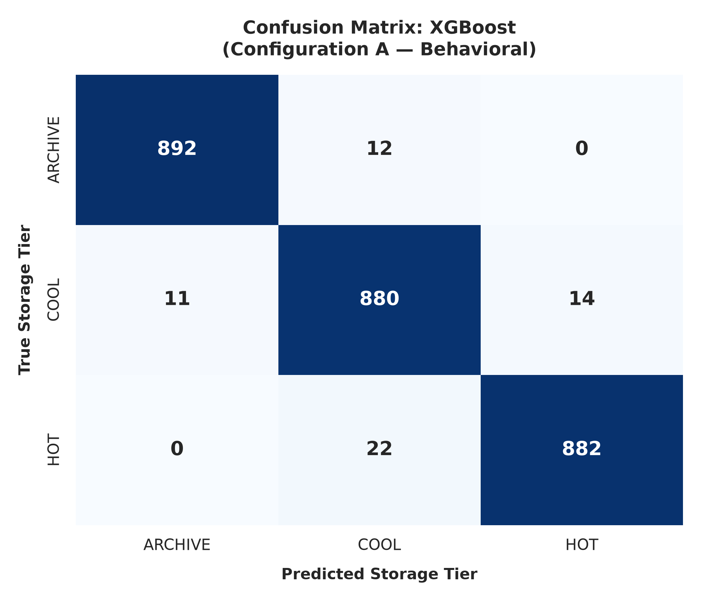
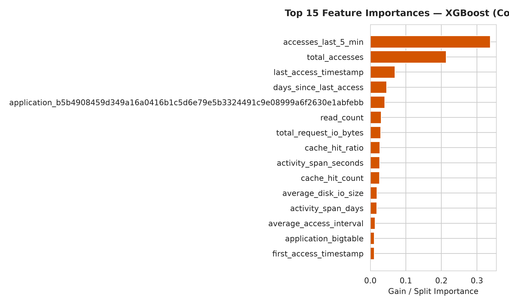
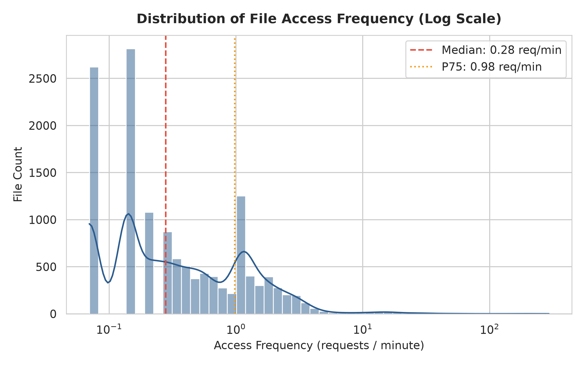
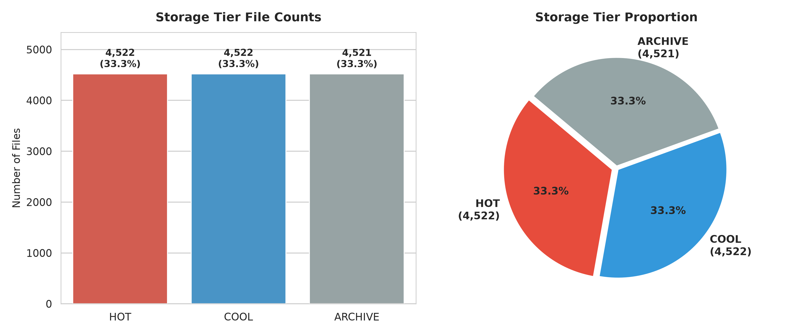

# Intelligent Cloud Storage Tier Predictor Using Machine Learning

> **"Machine Learning predicts. User preferences personalize. Generative AI explains."**

[](https://www.python.org/)
[](https://fastapi.tiangolo.com/)
[](https://react.dev/)
[](https://vitejs.dev/)
[](https://xgboost.readthedocs.io/)
[](https://scikit-learn.org/)
[](https://tailwindcss.com/)
[](LICENSE)

An end-to-end Data Mining and Artificial Intelligence system that classifies enterprise files into logical cloud storage tiers (**HOT**, **COOL**, and **ARCHIVE**) using empirical I/O access telemetry from Google's distributed storage architecture. The project combines **authoritative Machine Learning prediction**, a **transparent personalized user-intent engine**, and an **advisory Generative AI explanation layer**.

---

## Table of Contents

1. [Overview](#1-overview)
2. [Problem Statement](#2-problem-statement)
3. [Objectives](#3-objectives)
4. [Key Features](#4-key-features)
5. [System Architecture](#5-system-architecture)
6. [End-to-End Workflow](#6-end-to-end-workflow)
7. [Storage Tier Definitions](#7-storage-tier-definitions)
8. [Dataset](#8-dataset)
9. [Feature Engineering](#9-feature-engineering)
10. [Heuristic Label Generation](#10-heuristic-label-generation)
11. [Machine Learning Models](#11-machine-learning-models)
12. [Model Evaluation](#12-model-evaluation)
13. [Best Model Results](#13-best-model-results)
14. [Personalized Recommendation for New Files](#14-personalized-recommendation-for-new-files)
15. [Generative AI Layer](#15-generative-ai-layer)
16. [Web Application Pages](#16-web-application-pages)
17. [Technology Stack](#17-technology-stack)
18. [Project Structure](#18-project-structure)
19. [Installation](#19-installation)
20. [Dataset Setup](#20-dataset-setup)
21. [Backend Setup](#21-backend-setup)
22. [Frontend Setup](#22-frontend-setup)
23. [Environment Variables](#23-environment-variables)
24. [How to Run](#24-how-to-run)
25. [API Overview](#25-api-overview)
26. [Research Limitations](#26-research-limitations)
27. [Future Scope](#27-future-scope)
28. [Security Notes](#28-security-notes)
29. [Disclaimer](#29-disclaimer)
30. [Author / Project Information](#30-author--project-information)

---

## 1. Overview

In modern cloud environments (Google Cloud Storage, AWS S3, Microsoft Azure Blob Storage), organizations store petabytes of data across distinct storage classes:
- **HOT:** High-throughput, sub-millisecond retrieval, high monthly storage cost ($/GB).
- **COOL:** Infrequent access, balanced storage pricing, nominal retrieval fee.
- **ARCHIVE / COLD:** Deep preservation, lowest monthly storage cost (up to 80–90% lower than Hot), higher retrieval latency and per-GB egress penalties.

In practice, files are often kept in expensive Hot storage long after their active lifecycle has concluded, leading to severe cloud overspending. Conversely, prematurely moving critical files to cold archive creates steep retrieval penalties and operational latency.

This project delivers an intelligent, data-driven platform that monitors empirical file-access telemetry to automatically classify files into their optimal storage tier, evaluate candidate tiering optimizations, accommodate personalized user priorities for local files, and provide context-grounded AI explanations.

---

## 2. Problem Statement

Manual lifecycle configuration rules (such as *"archive files older than 90 days"*) are rigid, coarse, and oblivious to actual multi-dimensional usage dynamics. They fail because:
1. File age does not equal access frequency: old files may still be accessed continually by production pipelines.
2. Static policies ignore caching efficiency: files with near-100% cache hit ratios impose negligible primary storage load.
3. Access recency varies widely across enterprise application workloads.
4. New files (cold-start) lack historical trace logs, requiring explicit user intent policies rather than blind heuristic demotions.

A continuous, intelligent predictive system is required to bridge the gap between low-level telemetry, machine learning classification, and user preferences.

---

## 3. Objectives

- **Empirical Trace Analysis:** Ingest and analyze real-world high-resolution storage trace logs from Google's distributed storage architecture.
- **File-Level Feature Extraction:** Aggregate sub-millisecond I/O event streams into 37 rich temporal, behavioral, caching, and workload features per file.
- **Robust Pseudo-Ground Truth Formulation:** Construct a mathematically grounded Composite Storage Activity Index ($S_i$) to establish benchmark pseudo-labels without vendor bias.
- **Model Development & Benchmarking:** Train and rigorously evaluate Decision Tree, Random Forest, and XGBoost classifiers using 5-fold cross-validation and holdout testing.
- **Cold-Start Personalization:** Build a deterministic user-preference recommendation engine with explicit safety safeguards for local files without trace history.
- **Explainable Advisory AI:** Integrate an advisory Generative AI layer to explain model classifications, highlight trade-offs, and guide tier migrations without overriding empirical ML decisions.
- **Production-Grade Web Application:** Deliver a full-stack, responsive dashboard with FastAPI and React/Vite.

---

## 4. Key Features

- ⚡ **Authoritative ML Classification:** XGBoost behavioral model classifying historical trace files with **97.83% test accuracy**.
- 🔍 **Interactive File Explorer:** Browse 13,565 real files with server-side pagination, SHA-256 search, tier filtering, and 37-feature inspection.
- 🎯 **Dual-Mode File Prediction:**
  - *Mode 1 (Dataset File):* Live XGBoost behavioral prediction using observed access telemetry and confidence distributions.
  - *Mode 2 (Local File Upload):* In-browser metadata extraction (Web Crypto SHA-256, size, type) paired with questionnaire-driven personalized recommendations.
- 🛡️ **Safety Safeguard Engine:** Files marked `VERY IMPORTANT` are strictly guaranteed a minimum tier of `COOL` (never demoted to `ARCHIVE`), protecting critical assets from retrieval latency.
- ⚖️ **Signals Agreement Comparison:** Directly compare behavioral ML predictions against stated user preferences for any file.
- 💡 **Storage Optimization Engine:** Identifies misallocated files (e.g., Hot files dormant for extended periods) and surfaces potential tier-migration candidates.
- 🤖 **Context-Aware AI Assistant:** Conversational and contextual explanation layer powered by Google Gemini (with deterministic local fallback).
- 📊 **Model Performance Analytics:** Interactive confusion matrices, ROC/PR curves, permutation feature importance, and 5-fold cross-validation reports.

---

## 5. System Architecture

```
+-----------------------------------------------------------------------------------+
|                                 USER INTERFACE                                    |
|                      React 19 + Vite 8 + Tailwind CSS v4                          |
|  Dashboard | File Explorer | Predictions | Optimization | AI Assistant | Models  |
+------------------------------------------+----------------------------------------+
                                           | HTTP / REST API (JSON)
+------------------------------------------v----------------------------------------+
|                               FASTAPI BACKEND CORE                                |
|                           Port: 8000 | Python 3.10+                               |
|  +--------------------+  +----------------------+  +---------------------------+  |
|  | /api/predict       |  | /api/recommendation  |  | /api/ai/explain           |  |
|  | Live ML Inference  |  | Deterministic Policy |  | Generative AI Advisory   |  |
|  +---------+----------+  +----------+-----------+  +-------------+-------------+  |
+------------|------------------------|----------------------------|----------------+
             |                        |                            |
+------------v-----------+ +----------v-----------+ +--------------v----------------+
|  MACHINE LEARNING CORE | |  RECOMMENDATION SVC  | |     GENERATIVE AI LAYER       |
|  - XGBoost Classifier  | |  - Importance (1-5)  | |  - Google Gemini API          |
|  - Preprocessor Pipeline| |  - Usage Freq (1-5)  | |  - Grounded Knowledge Fallback|
|  - Label Encoder       | |  - Priority Score    | |  - Disclaimers & Boundaries   |
|  - 37 Feature Matrix   | |  - Minimum Safeguard | |                               |
+------------+-----------+ +----------------------+ +-------------------------------+
             |
+------------v----------------------------------------------------------------------+
|                               DATA & STORAGE LAYER                                |
|  - data/processed/file_level_features.csv (13,565 records, 37 engineered cols)   |
|  - models/best_model.joblib | models/model_metadata.json                          |
|  - reports/ml_results/*.json | reports/figures/*.png                              |
+-----------------------------------------------------------------------------------+
```

---

## 6. End-to-End Workflow

```
1. RAW TELEMETRY INGESTION (Google Research Thesios I/O Traces)
   - 168,590 event rows across 76 enterprise applications
   - Timestamps, byte offsets, cache hits, latencies, I/O zones
                                ↓
2. FEATURE ENGINEERING & AGGREGATION (src/data/create_file_dataset.py)
   - Aggregated by 64-char SHA-256 filename
   - 37 file-level features computed (velocity, recency, caching, proxy size)
                                ↓
3. HEURISTIC TARGET LABELING
   - Composite Storage Activity Index calculated: S_i in [0, 1]
   - Balanced tertile thresholds: HOT (4,522), COOL (4,522), ARCHIVE (4,521)
                                ↓
4. MODEL TRAINING & VALIDATION (src/models/train_models.py)
   - Stratified 80/20 train/test split (10,852 train / 2,713 test)
   - Decision Tree vs Random Forest vs XGBoost benchmarking
   - Serialized to models/best_model.joblib
                                ↓
5. SERVING & INTERACTION
   - FastAPI loads model pipeline and processed feature matrix
   - React UI serves live predictions, explorer, optimization, and AI explanations
```

---

## 7. Storage Tier Definitions

| Tier | Icon | Target Access Profile | Cost Profile | Minimum Retrieval SLA | Project Dataset Proportion |
| :--- | :---: | :--- | :--- | :--- | :---: |
| **HOT** | 🔥 | Frequent access, active pipelines, sub-second latency required. | High storage cost ($/GB), zero retrieval fees. | Real-time / Immediate | **33.34%** (4,522 files) |
| **COOL** | 🌤️ | Occasional access, periodic reference, backups, weekly batch jobs. | Balanced storage cost, low retrieval fees. | Standard / Seconds | **33.34%** (4,522 files) |
| **ARCHIVE** | ❄️ | Dormant or inactive files, compliance archives, historical backups. | Lowest storage cost (up to 90% savings), high retrieval penalties. | Minutes to Hours | **33.33%** (4,521 files) |

---

## 8. Dataset

- **Source:** Google Research Thesios I/O Traces.
- **Raw Trace Dimensions:** ~168,590 access events, 17 columns, ~41.5 MB (`data/raw/thesios_storage_trace.csv`).
- **Capture Window:** High-resolution empirical trace captured on **2024-01-15** over **861.38 seconds (~14.36 minutes)** across 76 enterprise storage applications.
- **Processed File Matrix:** **13,565 unique files**, **37 engineered features** (`data/processed/file_level_features.csv`).
- **Raw File Status:** The raw 41.5 MB CSV is excluded from Git to avoid repository bloat. Full documentation is provided in [`data/raw/README.md`](data/raw/README.md). The processed file-level feature matrix is tracked in the repository.

---

## 9. Feature Engineering

The project derives **37 file-level features** capturing temporal patterns, access velocity, transfer sizes, and caching behavior:

| Category | Feature Name | Description |
| :--- | :--- | :--- |
| **Identifiers** | `filename` | 64-character SHA-256 hash representing the file. |
| **Workload Context** | `application` | Enterprise application identifier responsible for the file. |
| **Access Frequency** | `total_accesses` | Total number of read and write I/O operations. |
| | `read_count` | Number of read operations. |
| | `write_count` | Number of write operations. |
| | `read_ratio` | Ratio of read operations: $\text{read\_count} / \text{total\_accesses}$. |
| | `access_frequency` | Access rate per second over active span. |
| | `accesses_last_5_min` | Number of access operations within the final 300 seconds of the trace. |
| | `accesses_last_7_days` | Cumulative access count (bounded by trace duration). |
| | `accesses_last_30_days` | Cumulative access count (bounded by trace duration). |
| | `unique_access_days` | Number of distinct calendar days with access (1 in single-day trace). |
| **Temporal Dynamics** | `first_access_timestamp` | Earliest observed I/O timestamp (epoch seconds). |
| | `last_access_timestamp` | Latest observed I/O timestamp (epoch seconds). |
| | `activity_span_seconds` | Total active observation duration: $T_{\text{last}} - T_{\text{first}}$. |
| | `activity_span_days` | Active observation duration converted to fractional days. |
| | `seconds_since_last_access`| Inactivity duration relative to trace end ($T_{\text{end}} - T_{\text{last}}$). |
| | `days_since_last_access` | Inactivity duration converted to fractional days. |
| | `file_age_days` | Approximate age calculated from creation timestamp `c_time`. |
| | `average_access_interval`| Mean time elapsed between consecutive access events. |
| | `median_access_interval` | Median time elapsed between consecutive access events. |
| **Transfer Volumes** | `average_request_io_size`| Mean request I/O size in bytes. |
| | `median_request_io_size` | Median request I/O size in bytes. |
| | `total_request_io_bytes` | Total request payload transferred in bytes. |
| | `average_response_io_size`| Mean response I/O size in bytes. |
| | `total_response_io_bytes`| Total response payload transferred in bytes. |
| | `average_disk_io_size` | Mean physical disk I/O size in bytes. |
| | `total_disk_io_bytes` | Total physical disk payload transferred in bytes. |
| **Caching Dynamics** | `cache_hit_count` | Number of operations served from memory cache. |
| | `cache_miss_count` | Number of operations requiring backend disk access. |
| | `cache_hit_ratio` | Proportion of reads served from cache: $\text{hits} / (\text{hits} + \text{misses})$. |
| | `flash_cache_ratio` | Proportion of operations handled by intermediate flash tier. |
| **Storage Architecture** | `dominant_io_zone` | Most frequent I/O zone (`WARM`, `COLD`, `UNKNOWN`). |
| | `dominant_service_class` | Primary QoS class (`THROUGHPUT_ORIENTED`, `LATENCY_SENSITIVE`). |
| | `dominant_redundancy_type`| Primary redundancy scheme (`REPLICATED`, `ERASURE_CODED`). |
| **Size & Activity** | `estimated_file_size_bytes_proxy` | Lower-bound proxy: $\max(\text{file\_offset} + \text{request\_io\_size\_bytes})$. |
| | `activity_score` | Composite Storage Activity Index ($S_i \in [0, 1]$). |
| | `storage_tier` | Heuristic pseudo-label (`HOT`, `COOL`, `ARCHIVE`). |

---

## 10. Heuristic Label Generation

Because real-world telemetry does not come pre-labeled with commercial storage tiers, the project defines a continuous **Composite Storage Activity Index** ($S_i$) based on normalized rank percentiles:

$$S_i = 0.40 \times \text{Rank}(\text{total\_accesses}) + 0.30 \times (1 - \text{Rank}(\text{seconds\_since\_last\_access})) + 0.15 \times \text{Rank}(\text{activity\_span}) + 0.15 \times \text{Rank}(\text{cache\_hit\_ratio})$$

### Thresholds & Class Assignment
Using balanced tertile quantiles:
- **$\tau_1 = 0.4061$** (33.33rd percentile)
- **$\tau_2 = 0.6027$** (66.67th percentile)

$$\text{Tier}(S_i) = \begin{cases} \textbf{HOT} & \text{if } S_i \ge 0.6027 \\ \textbf{COOL} & \text{if } 0.4061 < S_i < 0.6027 \\ \textbf{ARCHIVE} & \text{if } S_i \le 0.4061 \end{cases}$$

### Class Distribution
- **HOT:** 4,522 files (33.34%)
- **COOL:** 4,522 files (33.34%)
- **ARCHIVE:** 4,521 files (33.33%)

> [!NOTE]
> **Scientific Integrity Statement:** The labels `HOT`, `COOL`, and `ARCHIVE` are **heuristic pseudo-labels** derived from the project's activity-score methodology, NOT official Google Cloud vendor ground truth.

---

## 11. Machine Learning Models

Three supervised classifiers were implemented and evaluated across two feature configurations:
1. **Decision Tree Classifier:** Baseline interpretable tree with `max_depth=12`, `min_samples_split=20`.
2. **Random Forest Classifier:** Ensemble of 150 bagged decision trees with `n_estimators=150`, `max_depth=16`.
3. **XGBoost Classifier (Champion):** Gradient-boosted decision trees using `n_estimators=200`, `learning_rate=0.08`, `max_depth=6`, `subsample=0.85`, `colsample_bytree=0.85`.

### Evaluated Configurations:
- **Configuration A (Behavioral Pipeline):** Uses real-time access velocity, recency decay, and caching metrics alongside workload context.
- **Configuration B (Contextual / Cold-Start Pipeline):** Excludes direct access velocity and recency, assessing how much predictability exists from static size, age, and application context alone.

---

## 12. Model Evaluation

### Benchmark Results on Holdout Test Set (2,713 Files)

| Configuration | Model | Accuracy | Weighted Precision | Weighted Recall | Weighted F1 | Macro F1 | 5-Fold CV Accuracy |
| :--- | :--- | :---: | :---: | :---: | :---: | :---: | :---: |
| **Config A (Behavioral)** | **XGBoost (Best Model)** | **97.83%** | **0.9783** | **0.9783** | **0.9783** | **0.9783** | **97.75% ± 0.22%** |
| Config A (Behavioral) | Random Forest | 96.46% | 0.9652 | 0.9646 | 0.9648 | 0.9648 | 96.67% ± 0.32% |
| Config A (Behavioral) | Decision Tree | 95.21% | 0.9523 | 0.9521 | 0.9522 | 0.9522 | 95.68% ± 0.39% |
| **Config B (Contextual)** | XGBoost | 76.63% | 0.7780 | 0.7663 | 0.7697 | 0.7697 | 76.24% ± 0.45% |
| Config B (Contextual) | Random Forest | 76.19% | 0.7719 | 0.7619 | 0.7653 | 0.7653 | 75.88% ± 0.41% |
| Config B (Contextual) | Decision Tree | 73.68% | 0.7426 | 0.7368 | 0.7392 | 0.7392 | 73.41% ± 0.52% |

### Visual Artifacts in Repository

| Confusion Matrix (Behavioral Config A) | Feature Importance (XGBoost) |
| :---: | :---: |
|  |  |

| Access Frequency Distribution | Tier Distribution |
| :---: | :---: |
|  |  |

---

## 13. Best Model Results

The champion model is **XGBoost Configuration A (Behavioral)**:

> **"XGBoost predicts the project's heuristic storage-tier policy derived from observed file-access behavior with 97.83% test accuracy."**

### Per-Class Performance Breakdown

| Storage Tier | Precision | Recall | F1-Score | Support (Test Set) |
| :--- | :---: | :---: | :---: | :---: |
| **ARCHIVE** | **0.9825** | **0.9922** | **0.9873** | 904 |
| **COOL** | **0.9678** | **0.9678** | **0.9678** | 904 |
| **HOT** | **0.9845** | **0.9746** | **0.9800** | 905 |
| **Overall / Weighted** | **0.9783** | **0.9783** | **0.9783** | **2,713** |

### Top Predictive Features (Gain & Permutation)
1. `accesses_last_5_min` (33.77% gain importance)
2. `total_accesses` (21.37% gain importance, 38.15% permutation mean)
3. `last_access_timestamp` (6.92% gain importance)
4. `days_since_last_access` (4.60% gain importance, 20.58% permutation mean)
5. `cache_hit_count` (7.58% permutation mean)

---

## 14. Personalized Recommendation for New Files

When a user selects or uploads a new local file from their workstation, **historical Thesios access telemetry is unavailable**. 

### Scientific Distinction
- **We DO NOT pretend** that the ML model can make a valid behavioral prediction for an unobserved file.
- The 64-character SHA-256 hash is computed in-browser via the Web Crypto API strictly as a **unique identifier**. It carries zero behavioral telemetry.
- Uploaded file contents are **never** transmitted to external AI APIs to compute hashes or metadata.

### Transparent Deterministic Policy Engine
For local files, the system employs an explicit questionnaire:

1. **User Importance:**
   - `VERY IMPORTANT` = 5
   - `IMPORTANT` = 4
   - `MODERATELY USEFUL` = 3
   - `LESS IMPORTANT` = 2
   - `LEAST IMPORTANT` = 1

2. **Expected Usage Frequency:**
   - `VERY FREQUENTLY` = 5
   - `FREQUENTLY` = 4
   - `OCCASIONALLY` = 3
   - `RARELY` = 2
   - `ALMOST NEVER` = 1

$$\text{Priority Score} = \frac{\text{Importance Score} + \text{Expected Usage Score}}{2.0}$$

- **`4.0` – `5.0`** $\rightarrow$ **HOT**
- **`3.0` – `3.99`** $\rightarrow$ **COOL**
- **`1.0` – `2.99`** $\rightarrow$ **ARCHIVE**

### Safety Safeguard Override
$$\text{If Importance} = \text{VERY IMPORTANT} \implies \text{Minimum Recommended Tier} = \textbf{COOL (Never ARCHIVE)}$$
Even if expected usage is `ALMOST NEVER`, critical business assets are safeguarded from deep archive retrieval latency and egress restoration penalties.

---

## 15. Generative AI Layer

Generative AI serves strictly as an **advisory and explanatory layer**:
- **ML is the decision-maker:** The 97.83% XGBoost model makes authoritative classification decisions for dataset files.
- **AI does NOT override decisions:** Generative AI cannot alter, flip, or fabricate predicted storage tiers.
- **Explainability:** AI explains *why* the model assigned a tier, translates complex features (e.g., `accesses_last_5_min`, `cache_hit_ratio`), identifies migration risks, and contextualizes differences between ML behavior and user intent.
- **Server-Side API Security:** Generative AI API keys (`GEMINI_API_KEY`, `AI_API_KEY`) remain strictly on the server and are **never** committed or sent to client browsers.
- **Grounded Offline Fallback:** If no API key is provided, the backend falls back to a deterministic, project-aware knowledge engine that returns factually grounded responses without third-party dependencies.

---

## 16. Web Application Pages

The frontend provides **8 dedicated views**:

1. **Dashboard (`/dashboard`):** Real-time project telemetry, tier distributions, I/O zone breakdown, cache efficiency metrics, and dataset summaries.
2. **File Explorer (`/files`):** Paginated search table across 13,565 files with search, tier filtering, and comprehensive 37-feature inspection modals.
3. **File Prediction (`/prediction`):**
   - *Mode 1 (Dataset File):* Select files from the trace, run XGBoost live inference, inspect probabilities, and optionally compare with personal preferences.
   - *Mode 2 (Upload Local File):* Upload files, extract client-side metadata, answer the priority questionnaire, and receive safeguarded policy recommendations.
4. **Dataset Explorer (`/dataset`):** In-depth dataset provenance, column dictionary, temporal boundaries, and operational constraints.
5. **ML Performance (`/models`):** Interactive model comparisons, confusion matrices, ROC/PR curves, and feature importance rankings.
6. **How It Works (`/how-it-works`):** Educational step-by-step walkthrough detailing trace aggregation, index formulas, classification boundaries, and architecture.
7. **AI Assistant (`/ai-assistant`):** Interactive project-aware research chatbot capable of explaining features, anomalies, and storage tier concepts.
8. **Storage Optimization (`/optimization`):** Analysis view highlighting misallocated storage candidates (e.g., Hot files with high inactivity) and migration rationale.

---

## 17. Technology Stack

### Backend
- **Framework:** FastAPI (Python 3.10+)
- **Server:** Uvicorn (ASGI)
- **Data Processing:** Pandas, NumPy
- **Machine Learning:** Scikit-Learn, XGBoost, Joblib
- **Validation:** Pydantic v2
- **AI Integration:** Google GenAI SDK (`google-genai`), Python-dotenv

### Frontend
- **Framework:** React 19
- **Build Tool:** Vite 8
- **Styling:** Tailwind CSS v4
- **Icons:** Lucide React
- **Visualizations:** Recharts
- **Animations:** Framer Motion
- **Routing:** React Router DOM v7
- **Linter:** Oxlint

---

## 18. Project Structure

```
StorageTier-AI/
├── .env.example                               # Server environment variables template
├── .gitignore                                 # Git ignore protecting secrets and raw trace
├── DATASET_ANALYSIS.md                        # Stage 1 raw trace analysis & schema exploration
├── README.md                                  # Complete project documentation
├── test_personalized_recommendation.py        # Automated test suite for personalized engine
├── test_prediction_redesign.py                # Automated test suite for prediction modes
├── test_step3.py                              # Step 3 integration test (File Explorer & live inference)
├── test_step4.py                              # Step 4 integration test (Models & Dataset Explorer)
├── test_step5.py                              # Step 5 integration test (AI Assistant & Optimization)
├── backend/                                   # FastAPI backend service
│   ├── ai_service.py                          # Gemini & grounded local advisory engine
│   ├── main.py                                # FastAPI API application & routing
│   ├── recommendation_service.py              # Deterministic personalized scoring engine
│   ├── requirements.txt                       # Backend Python dependencies
│   └── test_backend.py                        # Backend endpoint validation suite
├── data/                                      # Data storage directory
│   ├── processed/                             # Processed dataset files
│   │   ├── DATA_DICTIONARY.md                 # 37-feature column definitions
│   │   ├── TIER_LABELING_METHODOLOGY.md       # Activity index formula & tertiles
│   │   └── file_level_features.csv            # 13,565 records × 37 features
│   └── raw/                                   # Raw dataset directory
│       └── README.md                          # Guide for raw Google Thesios trace CSV
├── frontend/                                  # React + Vite frontend application
│   ├── .env.example                           # Frontend environment variables template
│   ├── .gitignore                             # Frontend git ignore configuration
│   ├── .oxlintrc.json                         # Oxlint configuration
│   ├── index.html                             # Main HTML entry point
│   ├── package.json                           # Frontend dependencies & scripts
│   ├── vite.config.js                         # Vite build configuration
│   ├── public/                                # Static assets
│   │   ├── favicon.svg                        # Application favicon
│   │   ├── icons.svg                          # UI SVG symbols
│   │   └── figures/                           # 11 figures mirrored for web UI
│   └── src/                                   # React source code
│       ├── App.jsx                            # Root application component & routes
│       ├── main.jsx                           # Application bootstrap
│       ├── components/                        # Reusable UI components
│       │   ├── ErrorState.jsx
│       │   ├── FileDetailModal.jsx
│       │   ├── Header.jsx
│       │   ├── LoadingState.jsx
│       │   ├── Sidebar.jsx
│       │   ├── StatCard.jsx
│       │   └── TierBadge.jsx
│       ├── pages/                             # 8 page components
│       │   ├── AIAssistant.jsx
│       │   ├── Dashboard.jsx
│       │   ├── DatasetExplorer.jsx
│       │   ├── FileExplorer.jsx
│       │   ├── FilePrediction.jsx
│       │   ├── HowItWorks.jsx
│       │   ├── MLPerformance.jsx
│       │   └── StorageOptimization.jsx
│       └── services/                          # API communication client
│           └── api.js
├── models/                                    # Serialized machine learning artifacts
│   ├── best_model.joblib                      # Trained XGBoost pipeline (960 KB)
│   ├── label_encoder.joblib                   # Target label encoder (HOT/COOL/ARCHIVE)
│   ├── model_metadata.json                    # Feature lists, training metrics, hyperparameters
│   └── preprocessor.joblib                    # ColumnTransformer preprocessor
├── reports/                                   # Research reports & figures
│   ├── FEATURE_ENGINEERING_REPORT.md          # Stage 2 engineering documentation
│   ├── ML_MODEL_REPORT.md                     # Stage 3 machine learning report
│   ├── figures/                               # 11 high-resolution 300 DPI figures
│   └── ml_results/                            # Raw benchmark metrics & reports
│       ├── classification_reports.json
│       ├── cv_results.json
│       └── model_comparison.csv
└── src/                                       # Data & model training pipelines
    ├── data/
    │   └── create_file_dataset.py             # Feature engineering & dataset builder
    └── models/
        └── train_models.py                    # Multi-model training & validation script
```

---

## 19. Installation

### Prerequisites
- **Python:** Version 3.10, 3.11, 3.12, or 3.13
- **Node.js:** Version 18.x or 20.x+ (with npm)
- **Git:** Version 2.30+

### Clone the Repository
```powershell
git clone https://github.com/jogipavankumar22-gif/StorageTier-AI.git
cd StorageTier-AI
```

---

## 20. Dataset Setup

The processed file-level dataset (`data/processed/file_level_features.csv`) is **already included** in this repository. You can run the backend and frontend immediately without downloading raw files.

If you wish to re-aggregate the raw 41.5 MB trace:
1. Refer to [`data/raw/README.md`](data/raw/README.md).
2. Place `thesios_storage_trace.csv` into `data/raw/`.
3. Run:
   ```powershell
   python src/data/create_file_dataset.py
   ```

---

## 21. Backend Setup

1. Open PowerShell and navigate to the project root:
   ```powershell
   cd StorageTier-AI
   ```

2. (Optional but recommended) Create and activate a Python virtual environment:
   ```powershell
   python -m venv .venv
   .venv\Scripts\Activate.ps1
   ```

3. Install required Python packages:
   ```powershell
   pip install -r backend/requirements.txt
   ```

4. Create your local environment configuration:
   ```powershell
   Copy-Item .env.example .env
   ```
   *(Optional: Add your Google Gemini API key to `.env` if you wish to use live cloud AI)*

---

## 22. Frontend Setup

1. Navigate to the `frontend/` directory:
   ```powershell
   cd frontend
   ```

2. Install Node dependencies:
   ```powershell
   npm install
   ```

3. Create the frontend environment configuration:
   ```powershell
   Copy-Item .env.example .env
   ```

4. Return to the root directory:
   ```powershell
   cd ..
   ```

---

## 23. Environment Variables

### Root `.env` (Backend Configuration)
```env
# Optional Google Gemini API key for Generative AI explanations
# Get a free key at: https://aistudio.google.com/
GEMINI_API_KEY=your_gemini_api_key_here
AI_API_KEY=your_gemini_api_key_here

# Backend Server Host & Port
HOST=127.0.0.1
PORT=8000
ENVIRONMENT=development
CORS_ORIGINS=http://localhost:5173,http://127.0.0.1:5173
```

### `frontend/.env` (Frontend Configuration)
```env
# URL of the running FastAPI backend
VITE_API_BASE_URL=http://127.0.0.1:8000
```

---

## 24. How to Run

### Step 1: Start the FastAPI Backend
From the project root:
```powershell
uvicorn backend.main:app --host 127.0.0.1 --port 8000 --reload
```
The backend will start at: **`http://127.0.0.1:8000`**  
API Documentation (Swagger UI): **`http://127.0.0.1:8000/docs`**

### Step 2: Start the React Frontend
In a second terminal window:
```powershell
cd frontend
npm run dev
```
The frontend will start at: **`http://localhost:5173`** (or `http://127.0.0.1:5173`)

Open your browser and navigate to `http://localhost:5173` to explore the application!

---

## 25. API Overview

| Method | Endpoint | Description |
| :---: | :--- | :--- |
| `GET` | `/api/health` | Backend status, model load verification, total file count. |
| `GET` | `/api/dashboard/summary` | Real dataset summary metrics, total I/O bytes, average cache hit ratio. |
| `GET` | `/api/dashboard/tier-distribution` | Class distribution counts, percentages, I/O zones, and access bins. |
| `GET` | `/api/files` | Paginated file records with filtering (`search`, `tier`, `page`, `page_size`). |
| `GET` | `/api/files/{filename}` | Complete 37-feature record for a specific file hash. |
| `POST` | `/api/predict` | Run live XGBoost prediction on a dataset file hash or custom features. |
| `GET` | `/api/models/performance` | Champion model metrics, cross-validation stats, and multi-model benchmark. |
| `GET` | `/api/models/feature-importance` | Gain and permutation feature importance rankings. |
| `GET` | `/api/dataset/summary` | Dataset metadata, column counts, scope limitations. |
| `GET` | `/api/optimization/candidates` | Identification of files eligible for cost-saving tier demotions. |
| `POST` | `/api/recommendation/personalized` | Deterministic preference policy score for local uploaded files. |
| `POST` | `/api/ai/explain` | Advisory AI explanation for an ML prediction. |
| `POST` | `/api/ai/explain-recommendation` | Advisory AI explanation for a personalized recommendation. |
| `POST` | `/api/ai/explain-optimization` | Advisory AI explanation for a storage optimization candidate. |
| `POST` | `/api/ai/chat` | Interactive project-aware research assistant chat endpoint. |

---

## 26. Research Limitations

1. **Temporal Capture Window:** The underlying Google Thesios trace covers **861.38 seconds (~14.36 minutes)** on **2024-01-15**. Consequently, cumulative counters (`accesses_last_7_days`, `accesses_last_30_days`) are bounded by this duration and must not be interpreted as multi-month observations.
2. **Heuristic Pseudo-Labels:** `HOT`, `COOL`, and `ARCHIVE` classes represent calibrated project-defined policy tiers, not commercial vendor ground truth.
3. **Cold-Start Boundary:** Newly uploaded local files do not possess historical access logs; the system transparently utilizes stated user intent rather than attempting ungrounded ML inference.
4. **File Size Proxies:** The dataset records accessed byte offsets; file size is estimated as $\max(\text{file\_offset} + \text{request\_size})$.

---

## 27. Future Scope

- **Multi-Day Trace Integration:** Ingest extended multi-week storage logs to analyze seasonal and weekly access cyclicity.
- **Dynamic Policy Tuning:** Allow cloud administrators to adjust $\tau_1$ and $\tau_2$ tertile thresholds based on custom organization SLAs.
- **Automated Cloud Provider Connector:** Implement direct connectors for AWS S3 Lifecycle Rules and Google Cloud Storage Object Lifecycle Management.
- **Cost Arbitrage Simulation:** Real-time multi-cloud price comparison calculating dynamic retrieval vs. storage cost break-even points across AWS, GCP, and Azure.

---

## 28. Security Notes

- **Zero Secret Exposure:** Real API keys are **never** committed or stored in frontend bundles. All environment variables reside server-side.
- **Client-Side Hashing:** SHA-256 calculation for local files is executed inside the user's browser via the native Web Crypto API. File payloads are never uploaded to third-party AI endpoints to compute hashes.
- **No Remote Code Execution:** All model predictions run through isolated, verified scikit-learn/XGBoost pipelines without dynamic evaluation.

---

## 29. Disclaimer

This software was developed for academic, educational, and research purposes in Data Mining and Machine Learning. Storage tier recommendations and optimization opportunities represent analytical approximations based on empirical trace data. Production deployments should validate storage migration policies against active cloud vendor pricing tables, minimum storage duration constraints, and data retrieval SLAs.

---

## 30. Author / Project Information

- **Project Title:** Intelligent Cloud Storage Tier Predictor Using Machine Learning
- **Repository:** [https://github.com/jogipavankumar22-gif/StorageTier-AI](https://github.com/jogipavankumar22-gif/StorageTier-AI)
- **Author:** Pavan Kumar ([@jogipavankumar22-gif](https://github.com/jogipavankumar22-gif))
- **Primary Domain:** Data Mining, Machine Learning, Cloud Systems, Explainable AI
